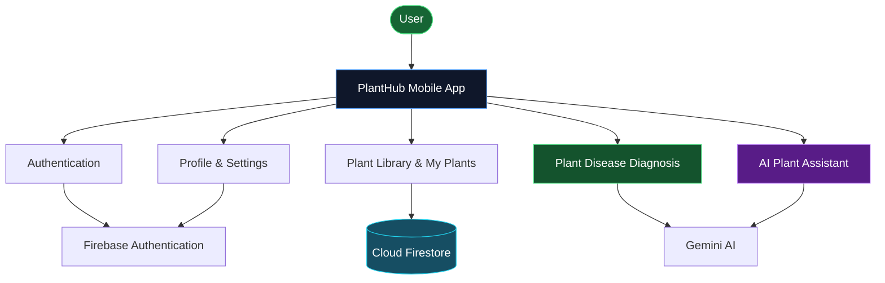

## 🌿 PlantHub — Application Overview

  
  
  

### About the Project

PlantHub is a Flutter application that helps users manage plants, explore plant care information, identify potential plant diseases, and access AI-powered assistance.

### Core Technologies

- **Flutter & Dart:** Mobile application development.
- **Firebase:** Authentication and cloud services.
- **Cloud Firestore:** Data storage.
- **Gemini AI:** AI-powered plant assistance and diagnosis.
