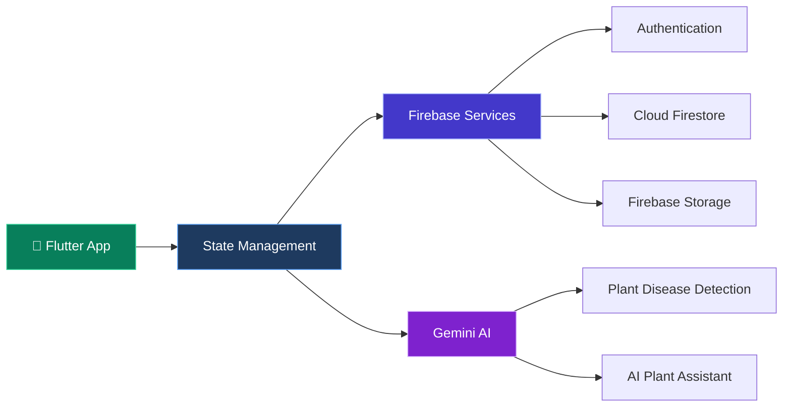

# 🌿 PlantHub

## System Architecture

## About PlantHub

PlantHub is a plant care application designed to help users
manage their plants, identify plant diseases, and get AI-powered
assistance for plant care.

## Tech Stack

- **Flutter & Dart** — Mobile application
- **Provider / BLoC** — State management
- **Firebase** — Authentication and data services
- **Cloud Firestore** — Database
- **Firebase Storage** — File and image storage
- **Gemini AI** — AI-powered plant assistance
