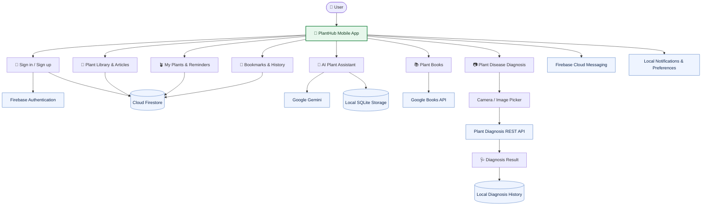

<div align="center">
  
  <h1>PlantHub 🌿</h1>
  <p><strong>Your companion for healthier plants.</strong></p>
  <p>A Flutter mobile application for plant care, plant-disease diagnosis, and plant-related learning.</p>
  <p>
    
    
    
    
  </p>
  <p>
    <a href="https://github.com/AbdulazizShaban2003/PlantHub-Application">Repository</a>
    · <a href="https://github.com/AbdulazizShaban2003">Developer Profile</a>
  </p>
</div>

---

## 📖 Overview

**PlantHub** is a plant-focused mobile application built with Flutter. It brings together tools for identifying possible plant diseases, exploring plant-care information, organizing personal plants, and learning through articles and an AI-powered chat experience.

The project combines a feature-oriented Flutter codebase with Firebase services, local storage, camera and image selection, localization, and a remote diagnosis API.

## 🧭 Application Workflow

The diagram below summarizes the main user journeys and the services they connect to. It reflects the integrations found in the project source code.



**How the diagnosis flow works:** the user captures or selects a plant image, PlantHub uploads it to the configured diagnosis REST API, and the app parses and displays the response. Diagnosis history is also supported locally. The diagnosis API is separate from the Gemini-powered chat assistant.

## 🧩 Main Integrations at a Glance

<p align="center">
  
  
  
  
  
  
</p>

> **Architecture note:** this is a feature-oriented Flutter application. Firebase, Gemini, the plant-diagnosis REST API, and Google Books serve different purposes; the diagnosis endpoint is not the same service as the AI chat.

## ✨ Features

- **Plant disease diagnosis** — capture or select a plant image and submit it to the diagnosis API to receive a result.
- **Diagnosis history** — retain and revisit previous diagnosis results using local storage.
- **Plant library and care guides** — browse plant information, care guidance, climatic conditions, and disease details.
- **My Plants** — keep a personal collection of plants and manage related images and care reminders.
- **AI chat assistant** — ask plant-related questions through a Gemini-powered chat interface.
- **Authentication** — email/password authentication, Google sign-in, email verification, and password reset through Firebase Authentication.
- **Bookmarks** — save plant articles for later reference.
- **Plant books** — browse, search, and view plant-related books using the Google Books API integration in the project.
- **Notifications and reminders** — Firebase messaging and local notifications support.
- **English and Arabic** — localized interface strings for both languages.
- **Additional usability features** — camera access, image sharing, connectivity feedback, loading/error states, and theme settings.

> Diagnosis results are informational and should not replace assessment by a qualified agricultural or plant-health specialist.

## 📱 App Screenshots

Explore the PlantHub mobile application and its main features.

<p align="center">
  
  
  
  
  
</p>


## 🧰 Tech Stack

| Area | Technologies |
| --- | --- |
| App framework | Flutter, Dart |
| State management | Provider, `flutter_bloc` / Cubit |
| Backend services | Firebase Authentication, Cloud Firestore, Firebase Cloud Messaging |
| AI assistant | Google Generative AI SDK (Gemini) |
| Plant diagnosis | REST API, Dio, multipart image upload |
| Local persistence | SQLite (`sqflite`), local file storage, shared preferences/cache utilities |
| Camera and media | Camera, Image Picker, cached network images |
| Localization | `easy_localization` (Arabic and English) |
| UI and utilities | Google Fonts, Lottie, Flutter SVG, Shimmer, Flutter Spinkit |

## 🏗️ Project Structure

The `lib/` directory is organized primarily by application feature, with shared infrastructure under `core/`.

```text
lib/
├── app/                 # App entry widget and global setup
├── config/              # Routes and theme configuration
├── core/                # Shared services, widgets, errors, utilities and providers
├── features/
│   ├── account/         # Profile, account settings and support screens
│   ├── articles/        # Plant articles, details and care information
│   ├── auth/             # Sign-up, login and password recovery
│   ├── bookMark/        # Saved articles
│   ├── booking/          # Plant-related book browsing and search
│   ├── chatAi/           # AI chat, messages and speech input
│   ├── diagnosis/        # Image-based diagnosis, results and history
│   ├── home/             # Home and notification controllers
│   ├── my_plant/          # Personal plant collection and reminders
│   ├── notification/    # Notification settings
│   ├── onBoarding/       # Onboarding flow
│   └── splash/           # Splash and initial navigation
├── firebase_options.dart
└── main.dart             # Application initialization

assets/
├── animation/            # Lottie animations
├── images/               # App illustrations and image assets
├── models/               # Model assets and labels
└── translations/         # Arabic and English translation files
```

## 🚀 Getting Started

### Prerequisites

Install the following before running the app:

- [Flutter SDK](https://docs.flutter.dev/get-started/install) compatible with the Dart SDK constraint in `pubspec.yaml` (`^3.7.2`).
- [Git](https://git-scm.com/downloads).
- Android Studio or another supported IDE, plus an Android emulator or physical device. Xcode is required to build for iOS on macOS.
- A configured Firebase project for the Firebase features.
- Valid credentials for the Gemini integration and access to the plant-diagnosis API if you want to use those features.

### 1. Clone the repository

```bash
git clone https://github.com/AbdulazizShaban2003/PlantHub-Application.git
cd PlantHub-Application
```

### 2. Install dependencies

```bash
flutter doctor
flutter pub get
```

### 3. Configure Firebase

This application initializes Firebase and uses Authentication, Cloud Firestore, and Firebase Messaging. Configure the Firebase project for your own development environment:

1. Create or select a project in the [Firebase Console](https://console.firebase.google.com/).
2. Register the Android/iOS applications with the correct package and bundle identifiers.
3. Configure the platform-specific Firebase files/options for your project. Use the official [FlutterFire setup guide](https://firebase.google.com/docs/flutter/setup).
4. Enable the Firebase products and sign-in providers required by the features you intend to use.
5. Set up the expected Firestore collections and security rules for your data. Do not use permissive production rules.

The repository contains Firebase configuration files tied to a particular project. Replace them with your own configuration when creating an independent deployment, and review their exposure and restrictions before publishing.

### 4. Configure external services

- **Plant diagnosis API:** the app currently sends image uploads to the API configured in `lib/features/diagnosis/doamin/diagnosis_api_service.dart`. Confirm that the service is available and that you have permission to use it before relying on diagnosis features.
- **Gemini AI:** the chat integration reads its API key through `AppStrings` in `lib/core/utils/app_strings.dart`. Do not commit personal API keys to source control. For production, move secret-dependent calls behind a trusted backend or use an appropriate secure configuration strategy; a key embedded in a mobile app can be extracted.
- **Google sign-in and notifications:** complete the platform-specific Firebase, OAuth, and notification configuration required for your target device.

### 5. Run the application

Connect a device or start an emulator, then run:

```bash
flutter run
```

To check the project's Dart code, run:

```bash
flutter analyze
```

To run the available Flutter tests, run:

```bash
flutter test
```

### Build an Android APK

```bash
flutter build apk --release
```

The output is normally created at `build/app/outputs/flutter-apk/app-release.apk`.

## 🔐 Configuration and Security Notes

- Never publish private credentials, service-account files, access tokens, or unrestricted API keys.
- Firebase client configuration is not a substitute for Firestore Security Rules, Firebase App Check, API restrictions, and proper backend authorization.
- If a key has already been committed publicly, revoke or rotate it and review its usage. Removing it from the latest commit alone does not remove it from Git history.
- Keep user data and local images private, and request camera, microphone, and notification permissions only when needed.

## 🧪 Testing

The repository includes a Flutter `test/` directory. Run the current test suite with:

```bash
flutter test
```

For future improvements, add focused unit tests for diagnosis-response parsing, repositories and providers, as well as widget tests for the main user flows.

## 🗺️ Roadmap Ideas

- Add a dedicated screenshots and demo section to document the main screens.
- Expand automated tests for authentication, diagnosis, plant management, and localization.
- Centralize environment-specific configuration and remove embedded secrets.
- Document the diagnosis API request/response contract and expected Firestore schema.
- Add a reproducible release workflow and versioned release notes.

## 🤝 Contributing

Contributions and suggestions are welcome.

1. Fork the repository.
2. Create a branch for your change: `git checkout -b feature/your-change`.
3. Make and test your changes.
4. Commit with a clear message.
5. Open a pull request describing the change and how it was tested.
